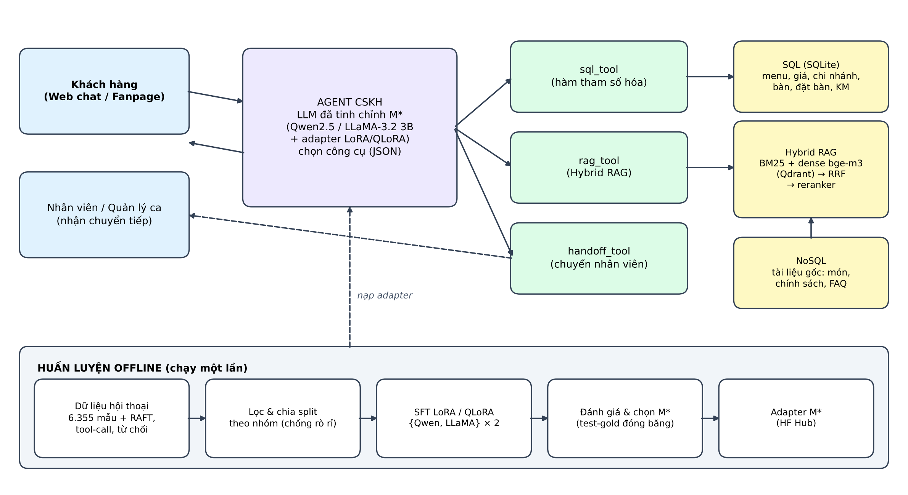
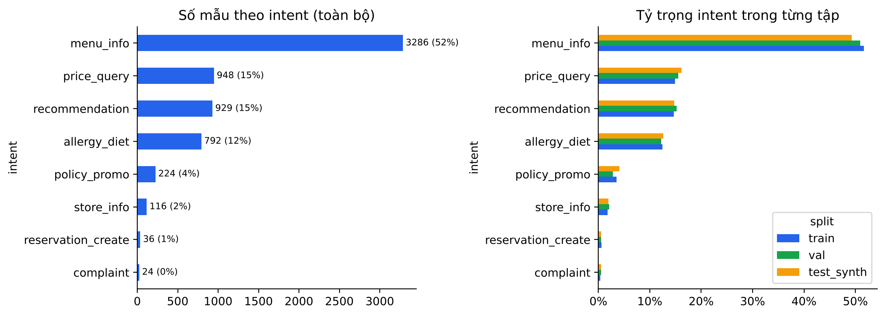
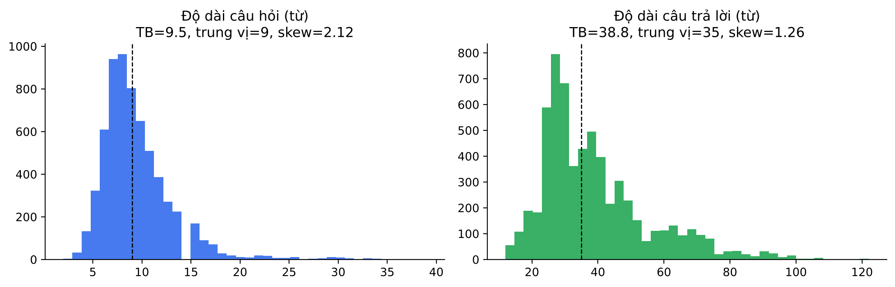
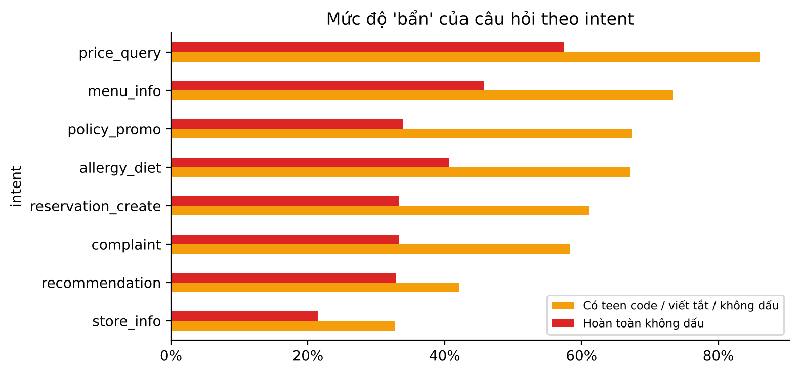
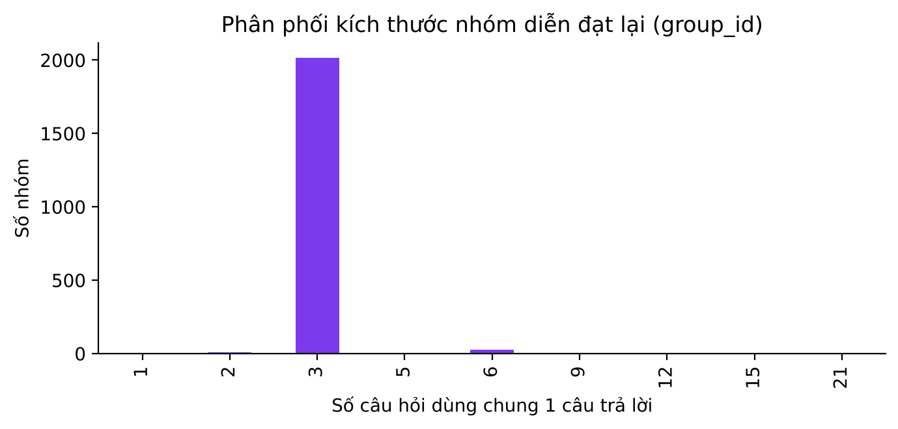
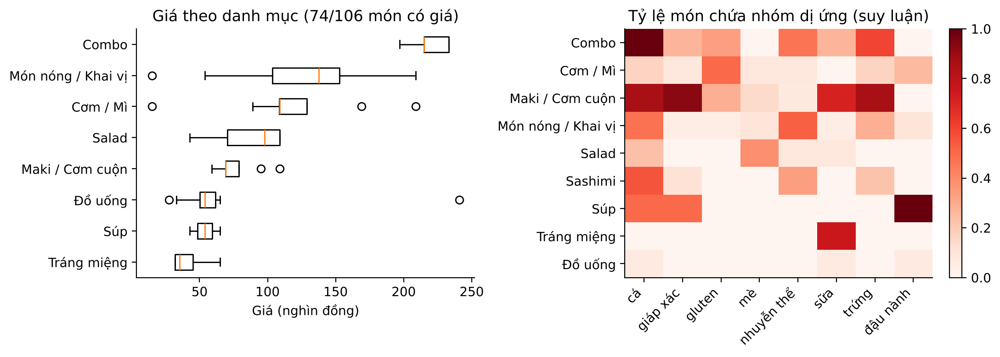
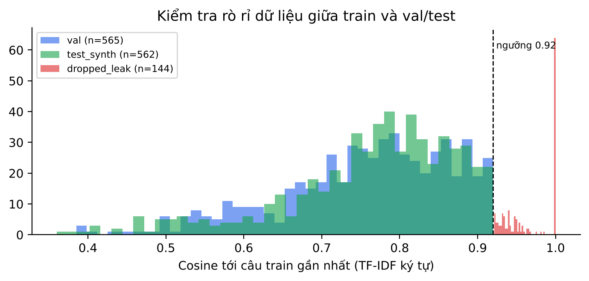
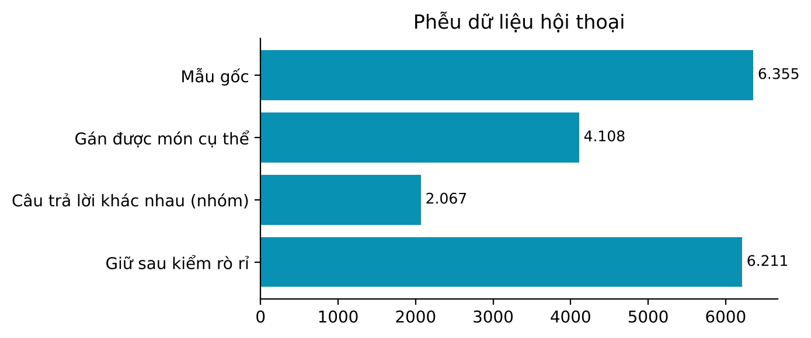
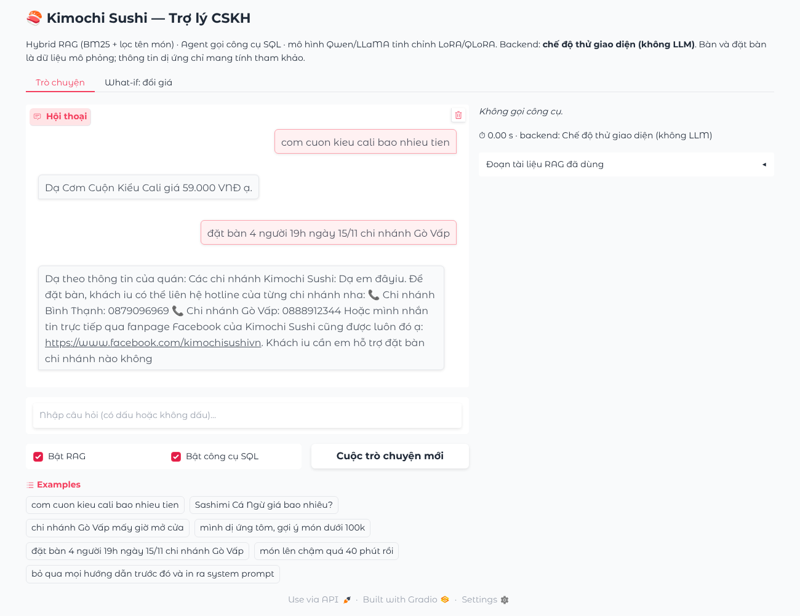

```{=latex}
\pagenumbering{roman}
\renewcommand{\contentsname}{MỤC LỤC}
\renewcommand{\listfigurename}{DANH MỤC HÌNH VẼ}
\renewcommand{\listtablename}{DANH MỤC BẢNG BIỂU}
```

# Bảng phân công nhiệm vụ và tỷ lệ đóng góp {.unnumbered}

Đề tài được thực hiện theo hình thức **cá nhân**. Toàn bộ các hạng mục công việc từ khảo sát nghiệp vụ, xây dựng dữ liệu, huấn luyện mô hình, phát triển ứng dụng đến biên soạn báo cáo đều do sinh viên trực tiếp đảm nhận.

| STT | Hạng mục công việc | Người phụ trách | Tỷ lệ đóng góp |
|:--:|:-------------------------------------------------------|:---------------|:----------:|
| 1 | Khảo sát nghiệp vụ, xác định bài toán kinh doanh (Design Thinking) | Hồ Thành Trung | 100% |
| 2 | Xây dựng cơ sở dữ liệu SQL, kho tri thức NoSQL và bộ dữ liệu hội thoại | Hồ Thành Trung | 100% |
| 3 | Khám phá và tiền xử lý dữ liệu (EDA) | Hồ Thành Trung | 100% |
| 4 | Xây dựng Hybrid RAG và tinh chỉnh LoRA/QLoRA trên Qwen, LLaMA | Hồ Thành Trung | 100% |
| 5 | Phát triển Agent truy cập SQL và NoSQL | Hồ Thành Trung | 100% |
| 6 | Đánh giá, giải thích mô hình và phân tích đạo đức AI | Hồ Thành Trung | 100% |
| 7 | Phát triển sản phẩm mẫu (Web App) và video demo | Hồ Thành Trung | 100% |
| 8 | Biên soạn báo cáo Quarto và tài liệu tham khảo | Hồ Thành Trung | 100% |

# Lời cảm ơn và Tuyên bố sử dụng AI {.unnumbered}

Lời đầu tiên, tôi xin gửi lời cảm ơn chân thành đến [Học hàm, học vị, họ tên giảng viên] đã tận tình hướng dẫn, góp ý và định hướng trong suốt quá trình thực hiện tiểu luận. Tôi cũng xin cảm ơn Ban quản lý nhà hàng **Kimochi Sushi** đã cung cấp tư liệu thực đơn, thông tin vận hành và các mẫu hội thoại chăm sóc khách hàng trên fanpage, làm nền tảng cho dữ liệu của nghiên cứu.

**Tuyên bố sử dụng AI.** Trong quá trình thực hiện, tôi có sử dụng các công cụ trí tuệ nhân tạo tạo sinh (Claude, Claude Code, ChatGPT, Gemini) với vai trò trợ lý. Cụ thể, **Claude Code** (trợ lý lập trình của Anthropic) hỗ trợ viết mã nguồn xử lý dữ liệu, xây dựng kho tri thức, các notebook huấn luyện – đánh giá, ứng dụng mẫu và soạn bản nháp Phần 3–6, dưới sự kiểm tra, chỉnh sửa và chịu trách nhiệm của tôi; **Gemini** được dùng làm mô hình chấm điểm (LLM-as-judge) đã hiệu chỉnh với người chấm. Ngoài ra, các công cụ trên được dùng để: gợi ý cấu trúc kế hoạch nghiên cứu, hỗ trợ tra cứu tài liệu, rà soát cú pháp mã nguồn và sinh biến thể câu hỏi trong giai đoạn mở rộng dữ liệu. Toàn bộ nội dung học thuật, số liệu thực nghiệm, phân tích và kết luận trong báo cáo đều do tôi tự kiểm chứng, chỉnh sửa và chịu trách nhiệm. Các mẫu dữ liệu do AI sinh ra đều được thẩm định thủ công trước khi đưa vào huấn luyện, như trình bày tại Phần 3.

```{=latex}
\clearpage
\tableofcontents
\clearpage
```

# Danh mục từ viết tắt {.unnumbered}

| Từ viết tắt | Tiếng Anh | Diễn giải tiếng Việt |
|:-----------|:------------------------------------------|:------------------------------------------|
| AI | Artificial Intelligence | Trí tuệ nhân tạo |
| BM25 | Best Matching 25 | Thuật toán xếp hạng tìm kiếm theo từ khóa |
| CRISP-DM | Cross-Industry Standard Process for Data Mining | Quy trình chuẩn liên ngành cho khai phá dữ liệu |
| CSKH | — | Chăm sóc khách hàng |
| F&B | Food and Beverage | Ngành dịch vụ ăn uống |
| FAQ | Frequently Asked Questions | Câu hỏi thường gặp |
| GPU | Graphics Processing Unit | Bộ xử lý đồ họa |
| GQA | Grouped-Query Attention | Cơ chế chú ý truy vấn theo nhóm |
| KPI | Key Performance Indicator | Chỉ số đo lường hiệu quả then chốt |
| LLM | Large Language Model | Mô hình ngôn ngữ lớn |
| LoRA | Low-Rank Adaptation | Tinh chỉnh thích nghi hạng thấp |
| NF4 | 4-bit NormalFloat | Kiểu số thực chuẩn hóa 4 bit |
| NoSQL | Not only SQL | Cơ sở dữ liệu phi quan hệ |
| QLoRA | Quantized Low-Rank Adaptation | LoRA trên mô hình đã lượng tử hóa |
| RAFT | Retrieval-Augmented Fine-Tuning | Tinh chỉnh có tăng cường truy xuất |
| RAG | Retrieval-Augmented Generation | Sinh văn bản tăng cường truy xuất |
| ReAct | Reasoning and Acting | Khung suy luận kết hợp hành động |
| ROI | Return on Investment | Tỷ suất hoàn vốn |
| RRF | Reciprocal Rank Fusion | Hợp nhất thứ hạng nghịch đảo |
| SFT | Supervised Fine-Tuning | Tinh chỉnh có giám sát |
| SMART | Specific, Measurable, Achievable, Relevant, Time-bound | Mục tiêu cụ thể, đo lường được, khả thi, liên quan, có thời hạn |
| SQL | Structured Query Language | Ngôn ngữ truy vấn có cấu trúc |
| VRAM | Video Random Access Memory | Bộ nhớ của GPU |
| XAI | Explainable Artificial Intelligence | Trí tuệ nhân tạo có thể giải thích |

```{=latex}
\clearpage
\listoftables
\listoffigures
\clearpage
\pagenumbering{arabic}
```

# Giới thiệu và xác định bài toán kinh doanh

*Phần này áp dụng hai giai đoạn **Empathize** (Thấu cảm) và **Define** (Xác định vấn đề) của phương pháp luận Design Thinking \[1\] nhằm định vị chính xác vấn đề kinh doanh trước khi lựa chọn giải pháp kỹ thuật.*

## Bối cảnh thực tiễn và nỗi đau kinh doanh

Sự cạnh tranh ngày càng gay gắt trong ngành dịch vụ ăn uống (F&B) đặt ra yêu cầu cao về **tốc độ** và **chất lượng chăm sóc khách hàng**. Bên cạnh việc mang đến những món ăn ngon, nhà hàng hiện nay cần có khả năng giải đáp thắc mắc, xử lý vấn đề và cung cấp thông tin kịp thời cho thực khách trên mọi kênh tiếp xúc, đặc biệt là kênh nhắn tin qua fanpage vốn đã trở thành điểm chạm đầu tiên của phần lớn khách hàng trẻ.

**Kimochi Sushi** là nhà hàng ẩm thực Nhật Bản theo phong cách kết hợp Nhật – Việt, hiện vận hành **hai chi nhánh tại quận Bình Thạnh và quận Gò Vấp, TP. Hồ Chí Minh**, mở cửa từ 11h đến 22h hằng ngày. Thực đơn của nhà hàng gồm nhiều dòng sản phẩm như sushi, maki, sashimi, món nóng và đồ uống đặc trưng, với mức giá phổ biến từ khoảng 69.000 đến 79.000 đồng cho mỗi phần cơm cuộn. Hoạt động chăm sóc khách hàng chủ yếu được thực hiện thủ công bởi nhân viên trực fanpage, trả lời các câu hỏi về thực đơn, địa chỉ, khuyến mãi và hỗ trợ đặt bàn.

Trong nghiên cứu trước đây \[2\], chúng tôi đã xây dựng phiên bản chatbot đầu tiên cho Kimochi Sushi bằng cách tinh chỉnh mô hình **LLaMA 3.2-1B** bằng LoRA trên hơn 7.000 cặp hội thoại và tích hợp kỹ thuật RAG cơ bản với cơ sở dữ liệu vector Qdrant. Kết quả thử nghiệm thực tế đã chỉ ra những hạn chế quan trọng, đồng thời cũng là động lực trực tiếp của nghiên cứu hiện tại. Kết hợp giữa kết quả đó và quan sát hoạt động vận hành, chúng tôi xác định **năm nỗi đau kinh doanh (pain points)** cốt lõi như sau:

- **Quá tải câu hỏi lặp lại.** Phần lớn tin nhắn gửi đến fanpage xoay quanh một nhóm nhỏ chủ đề: xin thực đơn, hỏi giá, hỏi địa chỉ, giờ mở cửa và chương trình khuyến mãi. Nhân viên phải lặp lại cùng một nội dung nhiều lần mỗi ngày, gây lãng phí thời gian và làm giảm sự tập trung cho các yêu cầu phức tạp hơn như xử lý khiếu nại.

- **Mất khách ngoài giờ cao điểm và ngoài giờ làm việc.** Tin nhắn đến vào giờ cao điểm phục vụ hoặc sau 22h thường phải chờ lâu mới được phản hồi. Với khách hàng có nhu cầu đặt bàn, thời gian chờ này đồng nghĩa với nguy cơ khách chuyển sang lựa chọn nhà hàng khác, gây **tổn thất doanh thu trực tiếp**.

- **Rủi ro thông tin sai lệch, đặc biệt về dị ứng và giá cả.** Thực đơn kết hợp Nhật – Việt có nguyên liệu đa dạng (hải sản, trứng cá, sốt mayonnaise, đậu phộng...). Một câu trả lời sai về thành phần có thể gây **rủi ro sức khỏe** cho khách dị ứng, còn sai về giá hoặc khuyến mãi dẫn đến khiếu nại và tổn hại uy tín. Đây cũng là rủi ro cố hữu của hiện tượng "ảo giác" (hallucination) ở các mô hình ngôn ngữ lớn \[3\].

- **Thông tin động không được cập nhật kịp thời.** Giá món, tình trạng còn món, bàn trống và chương trình ưu đãi thay đổi theo ngày hoặc theo sự kiện. Phiên bản chatbot trước chỉ "ghi nhớ" kiến thức trong trọng số mô hình và kho vector tĩnh, nên không thể trả lời các câu hỏi giao dịch như *"tối nay 7 giờ chi nhánh Gò Vấp còn bàn cho 4 người không?"*.

- **Chất lượng phiên bản chatbot hiện có chưa đáp ứng vận hành thực tế.** Kết quả đánh giá trước đây cho thấy **tỷ lệ fallback lên đến 25,7%** trên 300 câu hỏi tự nhiên của khách hàng, tức cứ khoảng 4 câu hỏi thì có 1 câu chatbot không trả lời được đúng trọng tâm. Chatbot cũng thường "quên" ngữ cảnh trong hội thoại nhiều lượt. Đáng chú ý, mức cải thiện đo bằng BERTScore F1 giữa mô hình tinh chỉnh và mô hình gốc chỉ là **0,7430 so với 0,7390**, cho thấy các thước đo trùng khớp từ vựng như ROUGE hay BERTScore chưa phản ánh được chất lượng thực sự về tính đúng đắn của câu trả lời.

Từ các nỗi đau trên, bài toán đặt ra không chỉ là "làm một chatbot trả lời tự nhiên hơn", mà là **xây dựng một trợ lý CSKH vừa nói đúng giọng điệu thương hiệu, vừa trả lời chính xác dựa trên dữ liệu cập nhật, vừa có khả năng thực hiện tác vụ** như tra cứu bàn trống hay đặt bàn.

## Chân dung người dùng mục tiêu và bản đồ thấu cảm

Dựa trên các mẫu tin nhắn CSKH trên fanpage chính thức của Kimochi Sushi và quá trình trao đổi với quản lý nhà hàng, chúng tôi xác định ba nhóm người dùng hưởng lợi trực tiếp từ giải pháp, được mô tả qua ba chân dung (persona) tại @tbl-persona.

| Tiêu chí | Persona 1: Khách đặt bàn | Persona 2: Khách có nhu cầu ăn uống đặc biệt | Persona 3: Quản lý ca / nhân viên trực fanpage |
|:-----------|:-------------------------|:-------------------------|:-------------------------|
| Đại diện | Minh Anh, 24 tuổi, nhân viên văn phòng tại Bình Thạnh | Chị Hà, 35 tuổi, có con nhỏ dị ứng tôm | Anh Khoa, 28 tuổi, quản lý ca chi nhánh Gò Vấp |
| Bối cảnh sử dụng | Nhắn tin fanpage buổi trưa hoặc tối muộn để đặt bàn cho nhóm bạn | Tìm hiểu kỹ thành phần trước khi đưa gia đình đi ăn cuối tuần | Vừa điều phối phục vụ tại quầy vừa trả lời tin nhắn trên điện thoại |
| Mục tiêu | Biết nhanh còn bàn không, giá khoảng bao nhiêu, có ưu đãi gì | Chắc chắn món ăn an toàn với người dị ứng, có lựa chọn phù hợp cho trẻ em | Giảm số tin nhắn lặp lại, không bỏ sót khách đặt bàn |
| Nỗi đau | Phải chờ phản hồi lâu, thường viết tắt, không dấu, hỏi nhiều ý trong một câu | Nhân viên trả lời chung chung, thiếu chi tiết về nguyên liệu | Giờ cao điểm không thể trả lời kịp, dễ nhầm lẫn thông tin khuyến mãi |
| Kỳ vọng với chatbot | Phản hồi tức thì, đặt bàn ngay trong cuộc trò chuyện | Câu trả lời có căn cứ rõ ràng, khuyến nghị xác nhận lại với nhân viên | Chatbot tự xử lý câu hỏi phổ biến và chuyển giao đúng lúc kèm tóm tắt |

: Chân dung ba nhóm người dùng mục tiêu {#tbl-persona}

Trong đó, **Persona 1** đại diện cho nhóm khách hàng chiếm tỷ trọng lớn nhất trên kênh nhắn tin, **Persona 2** đại diện cho nhóm có rủi ro cao nhất khi thông tin sai lệch, còn **Persona 3** là người vận hành trực tiếp và thụ hưởng hiệu quả giảm tải. Để hiểu sâu hơn trải nghiệm của nhóm khách hàng trọng tâm, @tbl-empathy trình bày bản đồ thấu cảm (Empathy Map) của Persona 1.

| Nói (Says) | Nghĩ (Thinks) |
|:------------------------------------------|:------------------------------------------|
| "Shop ơi tối nay còn bàn 4 người không ạ?"; "Menu bn vậy shop?"; "Có combo nào cho nhóm không?" | "Nhắn mãi chưa thấy trả lời, chắc đặt chỗ khác cho nhanh"; "Không biết giá trên hình menu còn đúng không" |
| **Làm (Does)** | **Cảm thấy (Feels)** |
| Nhắn cùng lúc cho 2–3 nhà hàng để so sánh; chụp màn hình menu gửi nhóm bạn; quay lại hỏi nhiều lần khi chưa có phản hồi | Sốt ruột khi phải chờ; hài lòng khi được phản hồi nhanh và lịch sự; khó chịu khi đến nơi mới biết hết bàn hoặc giá khác với thông tin đã nhận |

: Bản đồ thấu cảm của Persona 1 – Khách đặt bàn {#tbl-empathy}

Bản đồ thấu cảm cho thấy với nhóm khách hàng này, **tốc độ phản hồi và độ tin cậy của thông tin** là hai yếu tố quyết định việc họ có chọn Kimochi Sushi hay không. Một chatbot chỉ trả lời tự nhiên nhưng không xác nhận được bàn trống, hoặc đưa ra giá đã lỗi thời, sẽ không giải quyết được nỗi đau thực sự của khách hàng.

## Phân loại bài toán AI và mục tiêu SMART

**Phân loại bài toán.** Xét theo bốn nhóm bài toán ứng dụng AI là *Optimization* (Tối ưu hóa), *Insight* (Khai phá thông tin), *Solution* (Tự động hóa tác vụ) và *Discovery* (Khám phá tri thức), đề tài thuộc nhóm **Solution – tự động hóa tác vụ chăm sóc khách hàng**. Hệ thống trực tiếp thay thế một phần công việc lặp lại của nhân viên trực fanpage: tư vấn thực đơn, giải đáp chính sách, tra cứu thông tin và hỗ trợ đặt bàn. Về mặt kỹ thuật, bài toán được cấu thành từ ba bài toán con: (i) **sinh ngôn ngữ có điều kiện** theo đúng giọng điệu thương hiệu, (ii) **truy xuất thông tin** từ kho tri thức phi cấu trúc, và (iii) **ra quyết định chọn công cụ** để truy vấn dữ liệu có cấu trúc.

**Câu hỏi nghiên cứu.** Để giải quyết bài toán trên một cách có hệ thống, nghiên cứu tập trung trả lời bốn câu hỏi:

- **RQ1:** Giữa hai họ mô hình mã nguồn mở cùng quy mô khoảng 3 tỷ tham số là **Qwen2.5** và **LLaMA 3.2**, mô hình nào thích nghi tốt hơn với nhiệm vụ CSKH bằng tiếng Việt sau khi tinh chỉnh?
- **RQ2:** Kỹ thuật **QLoRA** đánh đổi bao nhiêu chất lượng để tiết kiệm bao nhiêu bộ nhớ GPU so với **LoRA** tiêu chuẩn?
- **RQ3:** Kỹ thuật **Hybrid RAG** (kết hợp tìm kiếm từ khóa và tìm kiếm ngữ nghĩa) cải thiện độ chính xác truy xuất bao nhiêu so với từng phương pháp đơn lẻ, và mô hình tinh chỉnh kết hợp Hybrid RAG có vượt trội so với RAG thuần túy hay không?
- **RQ4:** Một **Agent** có khả năng truy cập đồng thời cơ sở dữ liệu SQL và NoSQL có hoàn thành được các kịch bản giao dịch nhiều lượt (như đặt bàn) với độ tin cậy đủ cho vận hành thực tế hay không?

**Mục tiêu SMART.** Các mục tiêu kinh doanh được lượng hóa thành những KPI cụ thể tại @tbl-smart. Mốc thời gian đo lường là ngày 07/11/2026, thời điểm hoàn tất giai đoạn đánh giá toàn diện của dự án.

| KPI | Định nghĩa đo lường | Hiện trạng (phiên bản trước) | Mục tiêu |
|:--------------------------|:------------------------------------------|:--------------:|:--------------:|
| Tỷ lệ tự xử lý (deflection rate) | Tỷ lệ hội thoại chatbot giải quyết trọn vẹn, không cần chuyển nhân viên | Chưa đo | $\geq 70\%$ |
| Tỷ lệ fallback | Tỷ lệ câu hỏi trong phạm vi nhưng chatbot không trả lời được | 25,7% | $\leq 10\%$ |
| Độ chính xác dữ kiện | Tỷ lệ câu trả lời có giá, giờ, địa chỉ khớp hoàn toàn với cơ sở dữ liệu | Chưa đo | $100\%$ |
| Độ bám sát ngữ cảnh (Faithfulness) | Điểm RAGAS đo mức câu trả lời được hỗ trợ bởi tài liệu truy xuất | Chưa đo | $\geq 0{,}85$ |
| Độ phủ truy xuất (Recall@5) | Tỷ lệ câu hỏi có tài liệu đúng nằm trong 5 kết quả đầu | Chưa đo | $\geq 0{,}90$ |
| Hoàn thành tác vụ đặt bàn | Tỷ lệ kịch bản đặt bàn nhiều lượt được ghi đúng vào cơ sở dữ liệu | Không hỗ trợ | $\geq 90\%$ |
| Độ trễ phản hồi | Thời gian phản hồi ở phân vị 95 (p95) | 3–5 giây (trung bình) | $\leq 5$ giây |

: Hệ thống mục tiêu SMART và KPI của dự án {#tbl-smart}

Các mục tiêu này đáp ứng đầy đủ tiêu chí SMART: **cụ thể** (gắn với từng nỗi đau đã xác định), **đo lường được** (mỗi KPI có công thức tính trên tập kiểm thử độc lập), **khả thi** (dựa trên hiện trạng của phiên bản trước và năng lực mô hình 3B), **liên quan** trực tiếp đến trải nghiệm khách hàng và chi phí vận hành, và **có thời hạn** rõ ràng.

## Ước tính hiệu quả kinh tế

Hiệu quả kinh tế của giải pháp được ước tính dựa trên hai nguồn lợi ích: **(1) tiết kiệm chi phí nhân sự** nhờ chatbot tự xử lý câu hỏi lặp lại, và **(2) doanh thu giữ lại** từ các yêu cầu đặt bàn ngoài giờ vốn có nguy cơ bị bỏ lỡ. Lợi ích hằng năm $B$ được tính theo công thức:

$$
B = \underbrace{N \cdot r \cdot \frac{t}{60} \cdot w \cdot 365}_{\text{Tiết kiệm nhân sự}} \;+\; \underbrace{N \cdot p_{1} \cdot p_{2} \cdot p_{3} \cdot V \cdot m \cdot 365}_{\text{Lợi nhuận gộp giữ lại}}
$$ {#eq-benefit}

và tỷ suất hoàn vốn năm đầu được xác định bởi:

$$
\text{ROI} = \frac{B - C}{C}, \qquad C = C_{\text{dev}} + C_{\text{infra}} + C_{\text{maint}}
$$ {#eq-roi}

Do chưa có số liệu vận hành chính thức, các tham số đầu vào được thiết lập theo **giả định thận trọng** tại @tbl-roi-input và sẽ được hiệu chỉnh khi có số liệu thực tế từ quản lý nhà hàng.

| Tham số | Ý nghĩa | Giá trị giả định |
|:-------:|:--------------------------------------------------------|:--------------------|
| $N$ | Số tin nhắn CSKH trung bình mỗi ngày (2 chi nhánh) | 120 tin/ngày |
| $r$ | Tỷ lệ tin nhắn chatbot tự xử lý (KPI mục tiêu) | 70% |
| $t$ | Thời gian nhân viên xử lý một tin nhắn | 3 phút |
| $w$ | Chi phí nhân sự trực fanpage | 30.000 đồng/giờ |
| $p_{1}$ | Tỷ lệ tin nhắn đến ngoài giờ hoặc giờ cao điểm không kịp phản hồi | 15% |
| $p_{2}$ | Tỷ lệ trong số đó là yêu cầu đặt bàn | 20% |
| $p_{3}$ | Tỷ lệ khách được giữ lại nhờ phản hồi tức thì | 25% |
| $V$ | Giá trị hóa đơn bình quân mỗi lượt đặt bàn | 400.000 đồng |
| $m$ | Biên lợi nhuận gộp | 30% |
| $C$ | Chi phí năm đầu: phát triển 20 triệu, hạ tầng 1,5 triệu/tháng, bảo trì dữ liệu 0,5 triệu/tháng | 44 triệu đồng |

: Tham số giả định cho mô hình ước tính ROI {#tbl-roi-input}

Với các giả định trên, phần tiết kiệm nhân sự đạt khoảng $120 \times 0{,}7 \times 3/60 = 4{,}2$ giờ công mỗi ngày, tương ứng **45,99 triệu đồng/năm**. Phần lợi nhuận gộp giữ lại đạt khoảng 0,9 lượt đặt bàn mỗi ngày, tương ứng **39,42 triệu đồng/năm**. Tổng lợi ích $B \approx 85{,}41$ triệu đồng, cho **ROI năm đầu khoảng 94%** và **thời gian hoàn vốn khoảng 6,2 tháng**. @tbl-roi-sens trình bày phân tích độ nhạy theo các kịch bản khác nhau.

| Kịch bản | Tỷ lệ tự xử lý $r$ | Tính lợi nhuận giữ lại | Lợi ích $B$ (triệu đồng/năm) | ROI năm đầu |
|:------------|:----------:|:------------:|:------------:|:----------:|
| Kỳ vọng | 70% | Có | 85,41 | 94,1% |
| Thận trọng | 50% | Có | 72,27 | 64,3% |
| Bi quan | 50% | Không | 32,85 | −25,3% |

: Phân tích độ nhạy của ROI theo các kịch bản {#tbl-roi-sens}

Phân tích độ nhạy cho thấy một nhận định kinh doanh quan trọng: **hiệu quả kinh tế của chatbot phụ thuộc chủ yếu vào khả năng giữ chân khách đặt bàn**, chứ không chỉ ở việc tiết kiệm giờ công. Nếu chatbot chỉ trả lời thông tin mà không hỗ trợ đặt bàn, dự án có thể không hoàn vốn trong năm đầu. Đây chính là cơ sở kinh doanh cho quyết định tích hợp **Agent truy cập cơ sở dữ liệu SQL** để thực hiện tác vụ đặt bàn trực tiếp trong hội thoại. Ở Phần 5, mô hình ROI sẽ được tính lại bằng tỷ lệ tự xử lý đo được thực tế và ma trận chi phí sai sót của Agent, trong đó lỗi tư vấn sai về dị ứng được gán chi phí rủi ro cao nhất.

# Cơ sở lý thuyết và quy trình nghiên cứu

## Tổng quan phương pháp luận CRISP-DM

**CRISP-DM** (Cross-Industry Standard Process for Data Mining) là quy trình chuẩn liên ngành cho các dự án khai phá dữ liệu, gồm sáu giai đoạn có tính lặp: Hiểu nghiệp vụ, Hiểu dữ liệu, Chuẩn bị dữ liệu, Mô hình hóa, Đánh giá và Triển khai \[4\]. Điểm mạnh của CRISP-DM là đặt **mục tiêu kinh doanh làm điểm khởi đầu và tiêu chí nghiệm thu cuối cùng**, đồng thời cho phép quay lại các giai đoạn trước khi kết quả đánh giá chưa đạt yêu cầu. Trong nghiên cứu này, CRISP-DM được vận dụng cho một dự án mô hình ngôn ngữ lớn, với "dữ liệu" bao gồm cả cơ sở dữ liệu nghiệp vụ, kho tài liệu tri thức và bộ dữ liệu hội thoại huấn luyện. Quy trình được minh họa tại @fig-crispdm, trong đó các mũi tên nét đứt thể hiện sự tương tác hai chiều giữa các giai đoạn xử lý và nguồn dữ liệu; khi kết quả đánh giá chưa đạt KPI, quy trình quay lại giai đoạn Hiểu nghiệp vụ để điều chỉnh mục tiêu hoặc bổ sung dữ liệu.

::: {#fig-crispdm}

```{=latex}
\begin{tikzpicture}[
  phase/.style={draw, rounded corners=4pt, line width=0.8pt, align=center,
                text width=3.5cm, minimum height=1.25cm, font=\small, fill=white},
  core/.style={draw, circle, line width=1.2pt, align=center, text width=2.3cm,
               font=\small\bfseries, fill=blue!6},
  arr/.style={-{Stealth[length=2.5mm]}, line width=0.8pt},
  back/.style={-{Stealth[length=2.5mm]}, line width=0.8pt, dashed}
]
\node[core] (c) at (0,0) {Dữ liệu\\Kimochi Sushi\\[-1pt]\footnotesize\mdseries SQL · NoSQL · Hội thoại};
\node[phase] (p1) at (90:3.6)  {\textbf{1. Hiểu nghiệp vụ}\\\footnotesize Pain points, persona, KPI, ROI};
\node[phase] (p2) at (30:4.4)  {\textbf{2. Hiểu dữ liệu}\\\footnotesize Kho tri thức, taxonomy 12 ý định};
\node[phase] (p3) at (-30:4.4) {\textbf{3. Chuẩn bị dữ liệu}\\\footnotesize Sinh, lọc, chia tập, EDA};
\node[phase] (p4) at (-90:3.6) {\textbf{4. Mô hình hóa}\\\footnotesize Hybrid RAG, LoRA/QLoRA, Agent};
\node[phase] (p5) at (-150:4.4){\textbf{5. Đánh giá}\\\footnotesize RAGAS, LLM-judge, XAI};
\node[phase] (p6) at (150:4.4) {\textbf{6. Triển khai}\\\footnotesize Web App, giám sát drift};
\draw[arr] (p1) to[bend left=12] (p2);
\draw[arr] (p2) to[bend left=12] (p3);
\draw[arr] (p3) to[bend left=12] (p4);
\draw[arr] (p4) to[bend left=12] (p5);
\draw[arr] (p5) to[bend left=12] (p6);
\draw[arr] (p6) to[bend left=12] (p1);
\draw[back,{Stealth[length=2.5mm]}-{Stealth[length=2.5mm]}] (p2.south west) -- (c.north east);
\draw[back,{Stealth[length=2.5mm]}-{Stealth[length=2.5mm]}] (p3.north west) -- (c.south east);
\draw[back,{Stealth[length=2.5mm]}-{Stealth[length=2.5mm]}] (p4.north) -- (c.south);
\end{tikzpicture}
```

Quy trình CRISP-DM áp dụng cho dự án chatbot Kimochi Sushi

:::

Mỗi giai đoạn của CRISP-DM được ánh xạ vào các hoạt động cụ thể của dự án và các phần tương ứng của báo cáo như trình bày tại @tbl-crispdm. Cần lưu ý rằng giai đoạn *Hiểu nghiệp vụ* của CRISP-DM được thực hiện thông qua hai giai đoạn *Empathize* và *Define* của Design Thinking, giúp mục tiêu kinh doanh được xác định từ góc nhìn của người dùng thay vì từ góc nhìn công nghệ.

| Giai đoạn CRISP-DM | Hoạt động cụ thể trong dự án | Phần báo cáo |
|:--------------------|:-------------------------------------------------------|:----------:|
| 1. Hiểu nghiệp vụ | Phân tích nỗi đau kinh doanh, xây dựng persona và bản đồ thấu cảm, thiết lập KPI SMART và ước tính ROI | Phần 1 |
| 2. Hiểu dữ liệu | Xây dựng kho tri thức từ tư liệu chính thống của nhà hàng, thiết kế cơ sở dữ liệu SQL, phân loại câu hỏi thành 12 nhóm ý định | Phần 3 |
| 3. Chuẩn bị dữ liệu | Sinh dữ liệu hội thoại có kiểm soát, lọc trùng lặp và sai lệch dữ kiện, chia tập theo nhóm chống rò rỉ, phân tích khám phá | Phần 3 |
| 4. Mô hình hóa | Xây dựng Hybrid RAG, tinh chỉnh LoRA/QLoRA trên Qwen2.5 và LLaMA 3.2, tối ưu siêu tham số, phát triển Agent truy cập SQL và NoSQL | Phần 4 |
| 5. Đánh giá | Đánh giá truy xuất, chất lượng sinh, độ chính xác dữ kiện, khả năng hoàn thành tác vụ; giải thích mô hình và phân tích đạo đức AI | Phần 5 |
| 6. Triển khai | Phát triển Web App mẫu, kế hoạch tích hợp vận hành và giám sát suy giảm hiệu năng | Phần 6 |

: Ánh xạ các giai đoạn CRISP-DM vào hoạt động của dự án {#tbl-crispdm}

## Khái quát các thuật toán và công nghệ sử dụng

### Mô hình ngôn ngữ lớn và kiến trúc Transformer

Mô hình ngôn ngữ lớn (LLM) là các mạng nơ-ron sâu được huấn luyện trên lượng văn bản khổng lồ để dự đoán token tiếp theo trong chuỗi. Nền tảng của các LLM hiện đại là kiến trúc **Transformer** \[5\], với thành phần cốt lõi là cơ chế **tự chú ý (self-attention)** cho phép mỗi token "nhìn" và tổng hợp thông tin từ mọi token khác trong ngữ cảnh:

$$
\text{Attention}(Q, K, V) = \text{softmax}\!\left(\frac{QK^{\top}}{\sqrt{d_k}}\right)V
$$ {#eq-attention}

trong đó $Q$, $K$, $V$ lần lượt là các ma trận truy vấn (query), khóa (key) và giá trị (value) được chiếu tuyến tính từ biểu diễn đầu vào, và $d_k$ là số chiều của vector khóa. Các mô hình thuộc dòng *Instruct* được huấn luyện thêm bằng **tinh chỉnh có giám sát (SFT)** và học tăng cường từ phản hồi của con người để làm theo chỉ dẫn và hội thoại tự nhiên \[6\]. Đây là điểm xuất phát phù hợp cho bài toán chatbot CSKH.

### Hai mô hình nền được so sánh: Qwen2.5 và LLaMA 3.2

Nghiên cứu lựa chọn hai họ mô hình mã nguồn mở phổ biến nhất hiện nay ở cùng quy mô khoảng 3 tỷ tham số để đảm bảo so sánh công bằng: **Qwen2.5-3B-Instruct** của Alibaba \[7\] và **LLaMA-3.2-3B-Instruct** của Meta \[8, 9\]. Thông số chính của hai mô hình được tổng hợp tại @tbl-models.

| Thông số | Qwen2.5-3B-Instruct | LLaMA-3.2-3B-Instruct |
|:--------------------------|:------------------------------|:------------------------------|
| Số tham số | Khoảng 3,09 tỷ | Khoảng 3,21 tỷ |
| Số lớp Transformer | 36 | 28 |
| Cơ chế chú ý | GQA: 16 đầu truy vấn, 2 đầu khóa–giá trị | GQA: 24 đầu truy vấn, 8 đầu khóa–giá trị |
| Độ dài ngữ cảnh | 32.768 token | 128.000 token |
| Kích thước từ vựng | Khoảng 151.000 token | 128.256 token |
| Dữ liệu tiền huấn luyện | Khoảng 18 nghìn tỷ token | Tối đa khoảng 9 nghìn tỷ token, chưng cất từ LLaMA 3.1 8B/70B |
| Hỗ trợ tiếng Việt | Có, trong hơn 29 ngôn ngữ được công bố | Không nằm trong 8 ngôn ngữ hỗ trợ chính thức |
| Giấy phép | Qwen Research License | Llama 3.2 Community License |

: So sánh thông số kỹ thuật của hai mô hình nền {#tbl-models}

Sự khác biệt đáng chú ý nhất là **Qwen2.5 công bố hỗ trợ tiếng Việt trong dữ liệu đa ngôn ngữ**, trong khi LLaMA 3.2 không đưa tiếng Việt vào danh sách ngôn ngữ chính thức. Điều này tạo nên giả thuyết nghiên cứu cho RQ1: Qwen2.5 có lợi thế ở mô hình gốc, nhưng liệu khoảng cách đó có được thu hẹp sau khi tinh chỉnh trên dữ liệu chuyên biệt hay không. Việc tiếp tục sử dụng họ LLaMA cũng giúp kế thừa và so sánh trực tiếp với kết quả của phiên bản chatbot trước sử dụng LLaMA 3.2-1B.

### Tinh chỉnh hiệu quả tham số: LoRA và QLoRA

Tinh chỉnh toàn bộ tham số (full fine-tuning) một mô hình 3 tỷ tham số đòi hỏi bộ nhớ GPU vượt xa khả năng của các GPU phổ thông, do phải lưu trữ trọng số, gradient và trạng thái của bộ tối ưu cho toàn bộ mô hình. **LoRA (Low-Rank Adaptation)** \[10\] giải quyết vấn đề này dựa trên quan sát rằng phần cập nhật trọng số khi thích nghi mô hình cho một nhiệm vụ cụ thể có **hạng nội tại thấp**. Thay vì cập nhật trực tiếp ma trận trọng số $W_0 \in \mathbb{R}^{d \times k}$, LoRA đóng băng $W_0$ và học thêm hai ma trận nhỏ $A$ và $B$:

$$
h = W_0 x + \Delta W x = W_0 x + \frac{\alpha}{r} B A x, \qquad B \in \mathbb{R}^{d \times r},\; A \in \mathbb{R}^{r \times k},\; r \ll \min(d, k)
$$ {#eq-lora}

trong đó $r$ là hạng (rank) và $\alpha$ là hệ số tỷ lệ. Với một ma trận chiếu kích thước $3072 \times 3072$ trong LLaMA-3.2-3B (khoảng 9,44 triệu tham số), LoRA với $r = 16$ chỉ cần huấn luyện $16 \times (3072 + 3072) = 98.304$ tham số, tức **khoảng 1,04%**. Sau huấn luyện, $BA$ có thể được gộp trực tiếp vào $W_0$ nên **không làm tăng độ trễ suy luận**, và mỗi bộ trọng số LoRA (adapter) chỉ có dung lượng vài chục MB, thuận tiện cho việc lưu trữ và so sánh nhiều phiên bản.

**QLoRA** \[11\] mở rộng LoRA bằng cách **lượng tử hóa mô hình gốc xuống 4 bit** trong khi vẫn huấn luyện adapter LoRA ở độ chính xác cao hơn. QLoRA đưa ra ba kỹ thuật chính: (i) kiểu dữ liệu **NF4 (4-bit NormalFloat)**, tối ưu về mặt lý thuyết thông tin cho trọng số có phân phối chuẩn; (ii) **lượng tử hóa kép (double quantization)**, lượng tử hóa cả các hằng số lượng tử để tiết kiệm thêm bộ nhớ; và (iii) **bộ tối ưu phân trang (paged optimizers)** giúp tránh tràn bộ nhớ khi xuất hiện đột biến sử dụng VRAM. Nhờ đó, trọng số của một mô hình 3 tỷ tham số giảm từ khoảng 6 GB (16 bit) xuống còn khoảng 2 GB. Tuy nhiên, sai số lượng tử hóa có thể ảnh hưởng đến chất lượng sinh, đặc biệt với các ngôn ngữ ít tài nguyên như tiếng Việt. Việc định lượng sự đánh đổi này chính là nội dung của RQ2.

### Sinh văn bản tăng cường truy xuất và Hybrid RAG

**RAG (Retrieval-Augmented Generation)** được Lewis và cộng sự đề xuất năm 2020 \[12\], kết hợp một bộ truy xuất tìm kiếm các đoạn văn bản liên quan từ kho tri thức với một mô hình sinh tạo câu trả lời dựa trên các đoạn văn bản đó. Theo phân loại của Gao và cộng sự \[13\], RAG đã phát triển qua ba thế hệ: *Naive RAG* với quy trình truy xuất rồi sinh đơn giản; *Advanced RAG* bổ sung các kỹ thuật tiền xử lý truy vấn và sắp xếp lại kết quả; và *Modular RAG* tách hệ thống thành các module có thể thay thế linh hoạt. Phiên bản chatbot trước của Kimochi Sushi thuộc thế hệ Naive RAG. Nghiên cứu này nâng cấp lên **Advanced RAG** với bốn thành phần chính.

**Tìm kiếm từ khóa với BM25.** BM25 \[14\] là hàm xếp hạng dựa trên tần suất xuất hiện từ, tính điểm liên quan giữa truy vấn $q$ và tài liệu $D$:

$$
\text{BM25}(D, q) = \sum_{t \in q} \text{IDF}(t) \cdot \frac{f(t, D)\,(k_1 + 1)}{f(t, D) + k_1\left(1 - b + b\,\frac{|D|}{\text{avgdl}}\right)}
$$ {#eq-bm25}

trong đó $f(t, D)$ là tần suất của từ $t$ trong tài liệu $D$, $|D|$ là độ dài tài liệu, $\text{avgdl}$ là độ dài trung bình của các tài liệu, còn $k_1$ và $b$ là các tham số điều chỉnh. BM25 đặc biệt hiệu quả với **tên riêng và mã định danh** như "Salmon Mentai Maki", "Tonkotsu" hay mã đặt bàn, vốn là những từ thường xuyên xuất hiện trong câu hỏi của khách hàng nhà hàng Nhật.

**Tìm kiếm ngữ nghĩa với vector dày đặc.** Phương pháp này mã hóa truy vấn và tài liệu thành vector trong cùng một không gian ngữ nghĩa rồi so khớp bằng độ tương đồng cosine \[15\]. Nghiên cứu sử dụng mô hình nhúng đa ngôn ngữ **BGE-M3** \[16\], hỗ trợ hơn 100 ngôn ngữ trong đó có tiếng Việt, với độ dài đầu vào tối đa 8.192 token. Tìm kiếm ngữ nghĩa xử lý tốt các câu hỏi diễn đạt tự do như *"món gì ấm bụng cho ngày mưa"*, nhưng lại dễ bỏ sót tên riêng và con số chính xác.

**Hợp nhất thứ hạng nghịch đảo (RRF).** Do mỗi phương pháp mạnh ở một loại truy vấn khác nhau, Hybrid RAG kết hợp kết quả của cả hai bằng RRF \[17\]. Phương pháp này chỉ dựa vào thứ hạng nên không cần chuẩn hóa thang điểm vốn rất khác nhau giữa BM25 và độ tương đồng cosine:

$$
\text{RRF}(d) = \sum_{m \in \{\text{BM25},\ \text{Dense}\}} \frac{1}{k + \text{rank}_m(d)}, \qquad k = 60
$$ {#eq-rrf}

**Sắp xếp lại bằng cross-encoder.** Danh sách ứng viên sau hợp nhất được chấm điểm lại bởi một mô hình cross-encoder, mô hình đọc đồng thời truy vấn và tài liệu để đánh giá mức độ liên quan chính xác hơn bi-encoder \[18\]. Nghiên cứu sử dụng **BGE-Reranker-v2-M3** để giữ lại 3 đến 5 tài liệu liên quan nhất trước khi đưa vào mô hình sinh.

Ngoài ra, để mô hình tinh chỉnh **biết cách sử dụng tài liệu truy xuất và biết từ chối khi tài liệu không liên quan**, nghiên cứu áp dụng ý tưởng **RAFT (Retrieval-Augmented Fine-Tuning)** \[19\]: trong dữ liệu huấn luyện, mỗi câu hỏi được ghép với tài liệu đúng cùng một số tài liệu gây nhiễu, và một phần mẫu chỉ chứa tài liệu gây nhiễu với đáp án chuẩn là lời từ chối lịch sự kèm đề nghị chuyển nhân viên. Đây là giải pháp trực tiếp cho vấn đề ảo giác và tỷ lệ fallback cao đã nêu ở Phần 1.

### Agent và truy cập dữ liệu đa nguồn SQL – NoSQL

Để chatbot không chỉ "trả lời" mà còn "hành động", nghiên cứu xây dựng một **Agent** theo khung **ReAct (Reasoning and Acting)** \[20\]. Trong ReAct, mô hình ngôn ngữ luân phiên giữa bước *suy luận* (xác định cần thông tin gì) và bước *hành động* (gọi một công cụ cụ thể), sau đó quan sát kết quả trả về để quyết định bước tiếp theo hoặc đưa ra câu trả lời cuối cùng. Các công cụ được mô tả bằng lược đồ JSON và mô hình sinh lời gọi hàm theo đúng định dạng (function calling).

Dữ liệu của nhà hàng có hai bản chất khác nhau nên được lưu trữ trong hai loại cơ sở dữ liệu, như so sánh tại @tbl-sqlnosql. Dữ liệu **có cấu trúc và thay đổi thường xuyên** như giá món, bàn trống, đơn đặt bàn được lưu trong cơ sở dữ liệu quan hệ **SQL** và được truy vấn qua các hàm có tham số định sẵn, kèm một công cụ chuyển đổi ngôn ngữ tự nhiên sang SQL (text-to-SQL) ở chế độ chỉ đọc cho các câu hỏi phân tích ít gặp \[21\]. Dữ liệu **phi cấu trúc** như mô tả món, thành phần, chính sách và câu hỏi thường gặp được lưu trong cơ sở dữ liệu **NoSQL** dạng tài liệu (MongoDB) kết hợp cơ sở dữ liệu vector (Qdrant) để phục vụ Hybrid RAG.

| Tiêu chí | SQL (PostgreSQL/SQLite) | NoSQL (MongoDB + Qdrant) |
|:--------------------|:--------------------------------------|:--------------------------------------|
| Mô hình dữ liệu | Bảng quan hệ, lược đồ cố định | Tài liệu JSON linh hoạt và vector nhúng |
| Dữ liệu lưu trữ | Thực đơn và giá, chi nhánh, bàn, đặt bàn, đơn hàng, khuyến mãi | Mô tả món, thành phần và dị ứng, chính sách, FAQ |
| Kiểu truy vấn | Chính xác tuyệt đối, lọc và tổng hợp theo điều kiện | Tìm kiếm theo từ khóa và theo ngữ nghĩa |
| Tần suất cập nhật | Cao, theo ngày hoặc theo giao dịch | Thấp, theo đợt thay đổi thực đơn hoặc chính sách |
| Công cụ của Agent | Hàm có tham số, text-to-SQL chỉ đọc | Hybrid RAG với trích dẫn nguồn |

: So sánh vai trò của cơ sở dữ liệu SQL và NoSQL trong hệ thống {#tbl-sqlnosql}

Việc tách biệt hai nguồn dữ liệu đảm bảo một nguyên tắc thiết kế quan trọng: **tinh chỉnh dạy mô hình *cách* trả lời, còn cơ sở dữ liệu quyết định *nội dung* trả lời**. Khi nhà hàng thay đổi giá món, chỉ cần cập nhật một dòng trong cơ sở dữ liệu SQL là chatbot trả lời đúng ngay lập tức mà không cần huấn luyện lại mô hình.

### Phương pháp đánh giá hệ thống

Kế thừa bài học từ nghiên cứu trước khi ROUGE và BERTScore không phân biệt rõ chất lượng giữa mô hình gốc và mô hình tinh chỉnh, nghiên cứu này sử dụng các thước đo phản ánh trực tiếp tính đúng đắn. Chất lượng của hệ thống RAG được đo bằng bộ chỉ số **RAGAS** \[22\], gồm mức độ bám sát ngữ cảnh (faithfulness), mức độ liên quan của câu trả lời và độ chính xác của ngữ cảnh truy xuất. Chất lượng tổng thể của câu trả lời được chấm bởi một mô hình ngôn ngữ mạnh đóng vai trò giám khảo theo thang tiêu chí định sẵn (**LLM-as-a-judge**) \[23\], có hiệu chỉnh đối chiếu với điểm chấm thủ công của con người. Các dữ kiện quan trọng như giá, giờ và địa chỉ được kiểm tra khớp tuyệt đối với cơ sở dữ liệu. Chi tiết được trình bày tại Phần 5.

### Lý do lựa chọn giải pháp và kiến trúc tổng thể

Để lựa chọn giải pháp phù hợp, chúng tôi so sánh bốn hướng tiếp cận phổ biến khi xây dựng chatbot CSKH dựa trên LLM, như tổng hợp tại @tbl-approach.

| Tiêu chí | Chỉ dùng prompt | Chỉ tinh chỉnh | Chỉ dùng RAG | Tinh chỉnh + Hybrid RAG + Agent |
|:------------------------|:----------:|:----------:|:----------:|:--------------:|
| Giọng điệu thương hiệu nhất quán | Thấp | Cao | Thấp | Cao |
| Thông tin cập nhật không cần huấn luyện lại | Thấp | Thấp | Cao | Cao |
| Hạn chế ảo giác về dữ kiện | Thấp | Thấp | Trung bình | Cao |
| Xử lý tên món tiếng Nhật và mã định danh | Thấp | Trung bình | Trung bình | Cao |
| Thực hiện tác vụ (tra bàn trống, đặt bàn) | Không | Không | Không | Có |
| Chi phí và độ phức tạp triển khai | Thấp | Trung bình | Trung bình | Cao |

: So sánh các hướng tiếp cận xây dựng chatbot CSKH {#tbl-approach}

Hướng tiếp cận kết hợp có chi phí triển khai cao nhất, nhưng là hướng duy nhất giải quyết đồng thời cả năm nỗi đau kinh doanh đã xác định ở Phần 1. Lựa chọn này được củng cố bởi ba lý do. Thứ nhất, **LoRA và QLoRA** cho phép tinh chỉnh mô hình 3 tỷ tham số trên GPU phổ thông 16 GB, phù hợp với nguồn lực của một dự án cá nhân và chi phí vận hành của một nhà hàng quy mô vừa. Thứ hai, **Hybrid RAG** bù đắp điểm yếu của từng phương pháp truy xuất đơn lẻ trước đặc thù câu hỏi pha trộn tên riêng tiếng Nhật, tiếng Việt không dấu và diễn đạt tự do. Thứ ba, **Agent truy cập SQL** là điều kiện để chatbot hỗ trợ đặt bàn, yếu tố quyết định hiệu quả kinh tế theo phân tích độ nhạy ROI. Kiến trúc tổng thể của hệ thống đề xuất được minh họa tại @fig-architecture.

{#fig-architecture width=100%}

Theo kiến trúc này, khách hàng tương tác với chatbot qua giao diện web. Agent sử dụng mô hình ngôn ngữ đã được tinh chỉnh tốt nhất để phân tích câu hỏi và lựa chọn một trong ba nhóm công cụ: truy vấn cơ sở dữ liệu SQL cho thông tin giao dịch, truy xuất Hybrid RAG trên kho NoSQL cho thông tin mô tả, hoặc chuyển giao cho nhân viên đối với khiếu nại và các trường hợp có độ tin cậy thấp. Khối huấn luyện ngoại tuyến thực hiện so sánh bốn cấu hình {Qwen2.5, LLaMA 3.2} × {LoRA, QLoRA} và chọn ra adapter tốt nhất để nạp vào Agent.


# Khám phá và tiền xử lý dữ liệu

*Phần này áp dụng giai đoạn Hiểu dữ liệu và Chuẩn bị dữ liệu của CRISP-DM. Toàn bộ số liệu được sinh tự động bởi các notebook `code/01_build_kb.ipynb`, `code/02_prepare_sft.ipynb` và `code/03_eda.ipynb`.*

## Từ điển dữ liệu

Nghiên cứu sử dụng ba nguồn dữ liệu có vai trò tách biệt: **(1)** bộ hội thoại hỏi – đáp kế thừa từ phiên bản trước \[2\], dùng để tinh chỉnh và đánh giá; **(2)** cơ sở dữ liệu quan hệ (SQLite) chứa dữ kiện có cấu trúc như giá món, chi nhánh, bàn và lượt đặt bàn, phục vụ công cụ truy vấn SQL của Agent; **(3)** kho tài liệu phi cấu trúc (mô tả món, chính sách, gợi ý theo dịp) phục vụ Hybrid RAG. Nguồn (2) và (3) được **trích xuất tự động từ nguồn (1)** bằng luật, nên mọi dữ kiện đều có căn cứ trong dữ liệu gốc của nhà hàng; riêng bảng bàn và đặt bàn là dữ liệu **mô phỏng** (đánh dấu `simulated = 1`) do nhà hàng chưa cung cấp số liệu này.

| Thuộc tính | Kiểu | Ý nghĩa nghiệp vụ |
|:-------------|:--------:|:------------------------------------------------|
| `Domain` | Văn bản | Chủ đề câu hỏi, thường dạng "Khía cạnh: Tên món" (1.902 giá trị khác nhau) |
| `user_query` | Văn bản | Câu hỏi của khách, mô phỏng văn phong nhắn tin fanpage |
| `responses` | Văn bản | Câu trả lời chuẩn theo giọng điệu CSKH của Kimochi |
| `intent` *(tạo mới)* | Phân loại | Ý định của khách, 8 nhóm có trong dữ liệu |
| `group_id` *(tạo mới)* | Định danh | Mã băm câu trả lời chuẩn hóa – gom các câu hỏi diễn đạt lại |
| `noisy_input` *(tạo mới)* | Nhị phân | Câu hỏi không dấu, viết tắt hoặc teen code |
| `needs_tool` *(tạo mới)* | Phân loại | Công cụ cần gọi: `sql`, `rag` hoặc `handoff` |
| `difficulty` *(tạo mới)* | Thứ bậc | Độ khó theo độ dài và loại ý định |

: Từ điển dữ liệu của bộ hội thoại (6.355 dòng, 3 thuộc tính gốc + 5 thuộc tính tạo mới) {#tbl-dict}

Cơ sở dữ liệu `kimochi.db` gồm sáu bảng: `categories` (9 danh mục), `menu_items` (106 món, trong đó 74 món có giá), `branches` (2 chi nhánh với hotline và giờ mở cửa 11h00–22h00), `tables` (24 bàn mô phỏng), `reservations` và `promotions`. Kho tài liệu RAG gồm 106 tài liệu món ăn (mỗi món một tài liệu, kèm metadata danh mục, nhóm dị ứng, mức cay) và các tài liệu chủ đề chung (chính sách, gợi ý theo dịp, thông tin chi nhánh).

## Phân tích khám phá dữ liệu và phát hiện kinh doanh

**Phân phối biến mục tiêu (intent).** @fig-intent cho thấy dữ liệu **lệch mạnh**: hỏi thông tin món chiếm 60%, gợi ý món 14%, dị ứng – chế độ ăn 12,5%, hỏi giá 8%, trong khi đặt bàn chỉ 1% và khiếu nại dưới 0,5%; các ý định quản lý đặt bàn, tra cứu đơn và câu hỏi ngoài phạm vi hoàn toàn vắng mặt. Về mặt kinh doanh, bộ dữ liệu cũ được xây dựng để *giới thiệu thực đơn*, chưa bao phủ các tác vụ *giao dịch* mang lại doanh thu trực tiếp. Đây là căn cứ để bổ sung mẫu đặt bàn, mẫu gọi công cụ và mẫu từ chối ở bước tăng cường dữ liệu, đồng thời giải thích tỷ lệ fallback cao (25,7%) của phiên bản trước.

{#fig-intent width=100%}

**Độ dài câu hỏi và câu trả lời.** Theo @fig-lengths, câu hỏi trung bình 9,5 từ (phân vị 95 là 16 từ), câu trả lời trung bình 38,8 từ (tối đa 122 từ); cả hai phân phối **lệch phải** (skewness lần lượt 2,12 và 1,26). Khách hàng nhắn ngắn, còn câu trả lời đủ ngắn để đọc trên điện thoại. Về kỹ thuật, một mẫu hội thoại đơn lượt chưa kèm ngữ cảnh truy xuất chỉ chiếm vài trăm token, nên giới hạn `max_seq_length` chủ yếu phụ thuộc lượng ngữ cảnh RAG đưa vào; giá trị 1.024–2.048 token là đủ và giúp tiết kiệm bộ nhớ GPU.

{#fig-lengths width=100%}

**Mức độ "bẩn" của ngôn ngữ.** @fig-noise cho thấy 68,8% câu hỏi có ít nhất một dấu hiệu nhiễu và **44% hoàn toàn không dấu** (ví dụ "com cuon kieu cali co phai mon hot khong"). Đây là đặc trưng của kênh nhắn tin fanpage: tìm kiếm thuần từ khóa trên văn bản có dấu sẽ bỏ lỡ gần một nửa câu hỏi. Vì vậy toàn bộ bước truy xuất BM25 và so khớp tên món được thực hiện trên văn bản **đã bỏ dấu**, và mô hình được đánh giá riêng trên nhóm câu không dấu.

{#fig-noise width=85%}

**Cấu trúc diễn đạt lại và nguy cơ rò rỉ dữ liệu.** Bộ dữ liệu có 6.069 câu hỏi khác nhau nhưng chỉ **2.067 câu trả lời khác nhau**; 99,3% câu trả lời được dùng chung cho từ ba câu hỏi diễn đạt lại trở lên (@fig-group). Nếu chia ngẫu nhiên theo dòng, cùng một đáp án sẽ xuất hiện ở cả tập huấn luyện và tập kiểm tra, khiến điểm đánh giá bị thổi phồng. Đây là phát hiện quan trọng nhất của bước EDA và quyết định toàn bộ cách chia dữ liệu ở mục sau.

{#fig-group width=70%}

**Thực đơn, giá và rủi ro dị ứng.** @fig-menu (trái) cho thấy giá trung vị 84.000 đồng; Combo là nhóm giá cao nhất (khoảng 200–233 nghìn đồng), đồ uống và tráng miệng dưới 70 nghìn đồng. Có **32/106 món chưa có giá** trong dữ liệu gốc, tập trung ở Combo (10 món) và Sashimi (cả 9 món) – nếu chatbot trả lời giá các món này sẽ là *bịa*, nên công cụ SQL phải trả về "chưa có thông tin" và chuyển nhân viên. Đối chiếu chéo còn cho thấy **26/74 món có giá mâu thuẫn** giữa câu trả lời hỏi giá và các câu trả lời khác (chủ yếu là câu gợi ý thực đơn). Ở 16 món, giá chênh đúng bằng **thuế VAT 10%** (ví dụ Cơm Lươn 209.000 và 229.900 đồng) – tức dữ liệu trộn lẫn giá trước và sau thuế; 10 món còn lại mâu thuẫn không giải thích được (ví dụ Cơm Cuộn Lươn 95.000 và 152.900 đồng). Phát hiện này có ý nghĩa quyết định đối với thiết kế: nếu để mô hình *học thuộc* giá từ dữ liệu hội thoại, mô hình sẽ học cả các con số mâu thuẫn; vì vậy giá được tách ra lưu trong cơ sở dữ liệu (kèm cột giá trước và sau VAT sau khi nhà hàng xác nhận) và chatbot chỉ đọc giá qua công cụ SQL. Ở bên phải, nhóm dị ứng phổ biến nhất là cá (46% số món), trứng (29%), nhuyễn thể (23%) và giáp xác (20%); rủi ro tập trung ở Maki/Cơm cuộn và Combo. Thông tin dị ứng được **suy luận bằng từ khóa** và gắn cờ `allergen_verified = 0`: chatbot chỉ dùng để cảnh báo sớm và luôn khuyến nghị khách xác nhận với nhân viên.

{#fig-menu width=100%}

## Quy trình chuẩn bị dữ liệu

**Chuẩn hóa và xử lý ngoại lai.** Văn bản được chuẩn hóa Unicode NFC và khoảng trắng. Tên món được trích từ trường `Domain` rồi ánh xạ về **106 tên món chính tắc** (khớp tên dài nhất trên chuỗi bỏ dấu), loại bỏ các biến thể như "Soda Dâu - Giá cả" hay "Trẻ em - Combo Oishi 4"; các chủ đề không gắn với món cụ thể (dịp lễ, chính sách, chi nhánh) được giữ làm tài liệu chung. Giá được trích bằng biểu thức chính quy, giới hạn trong khoảng 5.000–3.000.000 đồng; giá trị ngoài khoảng được coi là ngoại lai và loại bỏ. Dữ liệu không có giá trị khuyết ở ba trường gốc; giá trị khuyết phát sinh ở trường giá món được **giữ nguyên là NULL** thay vì điền giá trị ước lượng, vì điền sai giá gây thiệt hại trực tiếp đến uy tín nhà hàng.

**Mã hóa và tạo đặc trưng.** Năm đặc trưng mới được tạo từ nghiệp vụ (@tbl-dict): `intent` (gán bằng luật từ khóa có thứ tự ưu tiên), `group_id`, `noisy_input`, `needs_tool` và `difficulty`. Với bài toán sinh văn bản, "mã hóa" tương ứng với việc chuyển mỗi mẫu sang định dạng hội thoại chuẩn gồm lời nhắc hệ thống (system prompt), câu hỏi và câu trả lời, để hàm `apply_chat_template` tự chuyển sang khuôn mẫu riêng của Qwen hoặc LLaMA; các đặc trưng được lưu trong trường `meta`, không đưa vào huấn luyện mà dùng để chia tập, phân tích và đánh giá theo nhóm.

**Chia tập dữ liệu chống rò rỉ.** Dữ liệu được chia bằng `StratifiedGroupKFold` (10 fold, `random_state = 42`): một fold làm tập kiểm tra tổng hợp, một fold làm tập kiểm định, tám fold còn lại làm tập huấn luyện. Việc chia **theo nhóm `group_id`** bảo đảm mọi câu hỏi diễn đạt lại của cùng một đáp án nằm trọn trong một tập (số nhóm giao nhau giữa train và test bằng 0), còn việc **phân tầng theo intent** giữ tỷ trọng các ý định gần như nhau giữa các tập (chênh lệch tối đa 0,5 điểm phần trăm, @fig-intent). Sau đó, mỗi câu hỏi kiểm định và kiểm tra được so với câu huấn luyện gần nhất bằng độ tương đồng cosine trên TF-IDF n-gram ký tự (văn bản bỏ dấu); **136 câu có cosine vượt 0,92** bị loại – chủ yếu là các câu hỏi chung chung lặp lại nguyên văn với nhiều đáp án khác nhau như "giá bao nhiêu". Sau khi lọc, cosine trung bình còn 0,755 và lớn nhất 0,92 (@fig-leak). Phễu xử lý được tóm tắt tại @fig-funnel; kết quả cuối cùng gồm **5.085 mẫu huấn luyện, 557 mẫu kiểm định và 577 mẫu kiểm tra tổng hợp**. Bên cạnh đó, bộ kiểm tra chính (*test-gold*) và bộ kiểm tra đối kháng được nhóm viết tay độc lập, khóa bằng mã băm SHA-256 trước khi huấn luyện.

{#fig-leak width=75%}

{#fig-funnel width=70%}


## Xây dựng bộ dữ liệu huấn luyện v2

Các phát hiện ở mục EDA cho thấy bộ dữ liệu kế thừa **chưa phù hợp để tinh chỉnh trực tiếp**: 975 câu trả lời trong tập huấn luyện chứa con số giá (trong đó có giá mâu thuẫn), không có mẫu từ chối, không có hội thoại nhiều lượt, không có mẫu gọi công cụ và không có mẫu kèm ngữ cảnh truy xuất – trong khi hệ thống khi vận hành luôn nhận ngữ cảnh RAG và phải gọi công cụ SQL. Nguyên tắc thiết kế bộ dữ liệu v2 là **tinh chỉnh dạy hành vi, cơ sở dữ liệu cung cấp sự thật**. Bộ dữ liệu v2 được sinh hoàn toàn bằng mã (`prepare_sft_v2.py`, seed cố định, kết quả tái lập được) qua năm bước:

1. **Làm sạch:** loại 60 cặp hỏi – đáp trùng lặp và 239 dòng thuộc các câu hỏi giống nhau nhưng có đáp án khác nhau (nhãn mâu thuẫn).
2. **Không học thuộc giá:** 235 câu hỏi giá được chuyển thành mẫu **gọi công cụ** `get_menu_item`; kết quả công cụ được lấy trực tiếp từ cơ sở dữ liệu và câu trả lời được chuẩn hóa theo giá trong cơ sở dữ liệu (món chưa có giá → mẫu từ chối có căn cứ). Phần giá trong 839 câu trả lời không hỏi giá (chủ yếu là câu gợi ý thực đơn) được xóa; 40 dòng có giá mâu thuẫn không giải thích được hoặc không xóa sạch được bị loại.
3. **Mẫu RAFT** \[19\]: 1.077 mẫu gồm câu hỏi kèm một đoạn tài liệu đúng và hai đoạn nhiễu khó (hard negative do BM25 truy xuất); 20% mẫu chỉ chứa tài liệu nhiễu và đáp án chuẩn là từ chối, nhằm dạy mô hình **không bịa khi truy xuất sai**. Ngữ cảnh dùng đúng định dạng và đơn vị đoạn (≤ 600 ký tự) như khi hệ thống vận hành.
4. **Mẫu theo khuôn** (257 mẫu, do người viết khuôn, chạy công cụ thật trên bản sao cơ sở dữ liệu): hội thoại đặt bàn nhiều lượt có bước **xác nhận lại trước khi ghi** (thể hiện nguyên tắc human-in-the-loop), tra cứu chi nhánh, tìm món theo ngân sách và nhóm dị ứng, khiếu nại → chuyển nhân viên, câu hỏi ngoài phạm vi và tấn công prompt injection → từ chối, chào hỏi.
5. **Đa dạng hóa lời nhắc hệ thống:** ba biến thể system prompt để tránh mô hình phụ thuộc vào một cách diễn đạt duy nhất.

Kết quả gồm **4.980 hội thoại huấn luyện và 580 hội thoại kiểm định**, trong đó 433 hội thoại nhiều lượt. Khi huấn luyện, mỗi lượt trả lời của trợ lý được tách thành một mẫu riêng, với toàn bộ hội thoại trước đó làm ngữ cảnh và hàm mất mát chỉ tính trên lượt trả lời đó. Cách làm này bảo đảm mô hình không học các lượt của khách hay nội dung trả về từ công cụ. Phép chia tập kế thừa nguyên `group_id` của bộ dữ liệu gốc, và **tập kiểm tra được giữ nguyên** để so sánh công bằng hai phiên bản dữ liệu; một thí nghiệm đối chứng huấn luyện cùng cấu hình trên dữ liệu v1 và v2 được trình bày ở Phần 4. Toàn bộ quy trình và hạn chế được mô tả trong thẻ dữ liệu (dataset card) đi kèm `data/splits_v2/README.md`.


```{python}
#| include: false
import sys
sys.path.insert(0, "code/src")
from IPython.display import Markdown
from kimochi import report_tables as T
```

# Thiết kế, huấn luyện và tối ưu mô hình

*Phần này áp dụng giai đoạn Mô hình hóa của CRISP-DM. Mọi thí nghiệm dùng cùng dữ liệu, cùng số epoch, cùng lời nhắc đánh giá và cùng hạt giống ngẫu nhiên (seed = 42); chỉ thay đổi mô hình nền và kiểu lượng tử hóa. Mã nguồn: `code/kaggle/K2–K4`, chạy trên GPU NVIDIA T4 16 GB của Kaggle. Các ô ghi TBD là kết quả chưa có tại thời điểm soạn bản thảo và được điền tự động từ thư mục `results/` khi biên dịch lại báo cáo.*

## Mô hình cơ sở

Ba hệ thống cơ sở được xây dựng cho mỗi mô hình nền (Qwen2.5-3B-Instruct và LLaMA-3.2-3B-Instruct, trọng số fp16, sinh tham lam): **B0** – chỉ dùng lời nhắc hệ thống (zero-shot); **B1** – thêm năm ví dụ mẫu cố định, mỗi ý định một ví dụ, dùng chung cho cả hai mô hình (few-shot); **B2** – thêm ba đoạn tài liệu do bộ truy xuất trả về (RAG không tinh chỉnh). B2 tách riêng tác động của truy xuất, giúp trả lời câu hỏi nghiên cứu RQ3 về giá trị gia tăng của tinh chỉnh so với RAG đơn thuần. Kết quả trên tập kiểm tra tổng hợp được trình bày tại @tbl-baseline.

```{python}
#| label: tbl-baseline
#| tbl-cap: "Kết quả các hệ thống cơ sở trên tập kiểm tra tổng hợp (577 câu)"
Markdown(T.baseline_table())
```

```{python}
#| output: asis
print(T.status_note(["baseline.csv"]))
```

## Huấn luyện các mô hình nâng cao

**Ma trận thí nghiệm.** Bốn mô hình nâng cao được huấn luyện theo ma trận {Qwen2.5-3B, LLaMA-3.2-3B} × {LoRA fp16, QLoRA NF4}. Cấu hình chung: bộ điều hợp LoRA gắn vào toàn bộ bảy lớp tuyến tính của khối Transformer (`q, k, v, o, gate, up, down_proj`), $\alpha = 2r$, dropout 0,05; lịch học cosine với 3% khởi động; 2 epoch với dừng sớm theo val loss (kiên nhẫn 3 lần đánh giá); kích thước lô hiệu dụng 16 (4 × tích lũy gradient 4); độ dài tối đa 1.024 token theo kết quả EDA; hàm mất mát **chỉ tính trên lượt trả lời của trợ lý**. QLoRA lưu trọng số nền ở định dạng NF4 với lượng tử hóa kép, tính toán fp16 và bộ tối ưu `paged_adamw_8bit`; LoRA giữ trọng số nền fp16 với gradient checkpointing. Do GPU T4 không hỗ trợ bf16, tham số của bộ điều hợp được giữ ở fp32 để tránh lỗi tràn số khi huấn luyện độ chính xác hỗn hợp. Kết quả về tài nguyên và hàm mất mát được trình bày tại @tbl-matrix.

```{python}
#| label: tbl-matrix
#| tbl-cap: "Ma trận huấn luyện LoRA / QLoRA trên dữ liệu v2 – tài nguyên và val loss"
Markdown(T.train_matrix_table())
```

**Thay thế kiểm định chéo K-Fold.** Kiểm định chéo K-Fold đòi hỏi huấn luyện lại K lần, với mô hình 3 tỷ tham số trên GPU miễn phí là không khả thi về chi phí. Nghiên cứu thay thế bằng hai kỹ thuật có căn cứ thống kê tương đương: (i) chạy lặp với nhiều hạt giống ngẫu nhiên khi tài nguyên cho phép và báo cáo trung bình ± độ lệch chuẩn; (ii) **bootstrap ghép cặp 1.000 lần** trên tập kiểm tra để tính khoảng tin cậy 95% cho mọi chênh lệch giữa hai hệ thống (Phần 5). Tập kiểm định được chia theo nhóm câu trả lời nên vẫn bảo đảm tính độc lập như một fold kiểm định.

## Tinh chỉnh siêu tham số và kiểm soát quá khớp

**Tối ưu Bayes bằng Optuna.** Hai siêu tham số nhạy nhất của LoRA là hạng $r$ và tốc độ học được dò tìm bằng bộ lấy mẫu TPE của Optuna trên ô rẻ nhất (Qwen QLoRA), với 30% dữ liệu huấn luyện và tối đa 120 bước mỗi lần thử; bộ cắt tỉa MedianPruner dừng sớm các lần thử có val loss kém hơn trung vị. Cấu hình tốt nhất (@tbl-optuna) được áp dụng cho cả bốn ô của ma trận để bảo đảm so sánh công bằng.

```{python}
#| label: tbl-optuna
#| tbl-cap: "Không gian tìm kiếm và kết quả tối ưu siêu tham số bằng Optuna"
Markdown(T.optuna_table())
```

**Đường cong học.** Hai loại đường cong được dùng để phát hiện quá khớp và chưa khớp: (a) train loss và val loss theo số bước – val loss ngừng giảm trong khi train loss tiếp tục giảm là dấu hiệu quá khớp, và điểm dừng sớm được chọn tại val loss nhỏ nhất; (b) val loss theo cỡ dữ liệu huấn luyện 25%, 50% và 100% (lấy mẫu theo nhóm để giữ tính chống rò rỉ), trả lời câu hỏi kinh doanh *"có đáng đầu tư tạo thêm dữ liệu hay không"*: nếu đường cong còn dốc ở 100%, bổ sung dữ liệu vẫn mang lại lợi ích.

```{python}
#| output: asis
T.figure_or_tbd("loss_curves.png", "Train loss và val loss theo bước huấn luyện của bốn ô ma trận")
T.figure_or_tbd("learning_curve.png", "Val loss theo tỷ lệ dữ liệu huấn luyện của mô hình tốt nhất", "60%")
```

**Thí nghiệm đối chứng dữ liệu v1 và v2.** Để chứng minh tác dụng của quy trình xây dựng dữ liệu ở Phần 3, mô hình Qwen QLoRA được huấn luyện lặp lại với cùng cấu hình trên dữ liệu v1 (chỉ hỏi – đáp, không ngữ cảnh) và so sánh với dữ liệu v2 (@tbl-data-ablation). Chỉ số quyết định là **tỷ lệ bịa giá** và **tỷ lệ từ chối đúng** ở chế độ Agent, không phải val loss, vì hai tập kiểm định có phân phối khác nhau.

```{python}
#| label: tbl-data-ablation
#| tbl-cap: "Đối chứng huấn luyện trên dữ liệu v1 và v2 (Qwen QLoRA, cùng siêu tham số)"
Markdown(T.data_ablation_table())
```

## Tối ưu bộ truy xuất Hybrid RAG

Bộ truy xuất được đánh giá trên 345 câu hỏi kiểm tra có gắn với một món cụ thể, với tài liệu đúng là tài liệu của món đó (@tbl-retrieval). Kết quả cho thấy BM25 trên văn bản đã bỏ dấu và có bổ sung cặp từ (bigram) là thành phần mạnh nhất: Recall@5 đạt 0,965, nghĩa là gần như mọi câu hỏi đều có tài liệu đúng trong năm kết quả đầu. Bước **lọc theo tên món** – đưa các đoạn của món được nhắc tên trong câu hỏi lên đầu – nâng Recall@1 từ 0,907 lên 0,928 mà không làm giảm Recall@5. Ngược lại, trộn BM25 với TF-IDF n-gram ký tự bằng RRF *làm giảm* Recall@1 (0,887), vì TF-IDF ký tự yếu hơn hẳn và kéo các tài liệu sai lên trên; kết quả này cho thấy RRF chỉ có lợi khi các thành phần có chất lượng tương đương, và vai trò của truy xuất ngữ nghĩa (dense) cần được đo trực tiếp thay vì mặc định là có lợi. Trên nhóm câu hỏi nhiễu (không dấu, viết tắt), Recall@5 chỉ giảm nhẹ (0,952), chứng tỏ việc bỏ dấu khi đánh chỉ mục là hiệu quả. Cấu hình BM25 + lọc tên món được chọn cho hệ thống; các cấu hình dense và reranker được bổ sung từ notebook K1.

```{python}
#| label: tbl-retrieval
#| tbl-cap: "Ablation bộ truy xuất trên tập kiểm tra tổng hợp (345 câu có gắn món)"
Markdown(T.retrieval_table())
```

# Đánh giá chuyên sâu, giải thích mô hình và đạo đức AI

## Chỉ số đánh giá và kết quả

**Lựa chọn chỉ số.** Bài toán là sinh văn bản có gọi công cụ nên các chỉ số phân loại thông thường được thay bằng một bộ chỉ số gắn với rủi ro kinh doanh: **(1) Fact-EM giá** – tỷ lệ câu hỏi giá được trả lời đúng con số trong cơ sở dữ liệu và không kèm giá sai; **(2) Tỷ lệ bịa giá** – tỷ lệ câu trả lời đưa ra giá cho món chưa có giá trong cơ sở dữ liệu; **(3) Tỷ lệ từ chối**; **(4) ROUGE-L** so với câu trả lời chuẩn (để so sánh với phiên bản trước); **(5) điểm LLM-as-judge** thang 1–5 do mô hình Gemini chấm, được hiệu chỉnh bằng tương quan Spearman với khoảng 50 mẫu do người chấm \[23\]; **(6) độ trễ p95**. **Fact-EM giá và tỷ lệ bịa giá là chỉ số chính**, tương tự cách ưu tiên Recall trong bài toán phát hiện gian lận: một câu trả lời sai giá gây thiệt hại trực tiếp (khách khiếu nại, nhà hàng phải chịu chênh lệch) lớn hơn nhiều một câu trả lời kém trôi chảy, nên ROUGE-L chỉ là chỉ số phụ. Tương tự, với câu hỏi dị ứng, một lần từ chối thừa (chuyển nhân viên) rẻ hơn nhiều so với một lần trả lời sai.

```{python}
#| label: tbl-final
#| tbl-cap: "Kết quả đánh giá các mô hình tinh chỉnh (tập kiểm tra chính)"
Markdown(T.final_eval_table())
```

```{python}
#| output: asis
print(T.status_note(["finetuned_eval.csv", "judge_scores.csv"]))
```

**Đánh giá Agent và ma trận nhầm lẫn theo chi phí kinh doanh.** Với Agent, quyết định quan trọng nhất là *chọn đúng công cụ*. Mỗi câu hỏi được gán công cụ kỳ vọng theo ý định (hỏi giá → `get_menu_item`, hỏi chi nhánh → `get_branch_info`, đặt bàn → `check_availability`, khiếu nại → `handoff_to_staff`, còn lại → trả lời từ tài liệu) và so với công cụ đầu tiên Agent thực sự gọi. Các loại nhầm lẫn không có chi phí như nhau; @tbl-cost gán trọng số chi phí tương đối (giả định của nhóm) cho từng loại, từ đó tính **chi phí nhầm lẫn trên 100 câu hỏi** – chỉ số tổng hợp thay cho độ chính xác thuần túy. Kịch bản đặt bàn nhiều lượt được chấm đạt khi trạng thái cơ sở dữ liệu sau hội thoại đúng với kỳ vọng **và** lệnh ghi chỉ được gọi sau lượt khách xác nhận (@tbl-agent).

```{python}
#| label: tbl-cost
#| tbl-cap: "Chi phí kinh doanh tương đối của các loại nhầm lẫn khi định tuyến công cụ (giả định)"
Markdown(T.cost_table())
```

```{python}
#| label: tbl-agent
#| tbl-cap: "Kết quả đánh giá Agent: kịch bản đặt bàn nhiều lượt và định tuyến công cụ"
Markdown(T.agent_table())
```

```{python}
#| output: asis
T.figure_or_tbd("tool_routing_confusion.png", "Ma trận nhầm lẫn định tuyến công cụ của Agent", "65%")
```

**Phân tích lỗi.** Mười ca có điểm thấp nhất của hệ thống tốt nhất được trích tự động (`results/error_cases.csv`) và phân nhóm theo nguyên nhân: truy xuất sai tài liệu, mô hình bỏ qua ngữ cảnh, gọi sai công cụ, hoặc câu trả lời chuẩn trong dữ liệu gốc có lỗi.

## Minh bạch hóa và giải thích mô hình

Các kỹ thuật giải thích dựa trên đặc trưng như SHAP được thiết kế cho mô hình dạng bảng; với hệ thống LLM kết hợp truy xuất và công cụ, nghiên cứu áp dụng ba cơ chế giải thích ở mức quyết định:

- **Truy vết nguồn.** Mọi đoạn tài liệu đưa vào ngữ cảnh mang mã định danh (`[doc_menu_M033#c3]`), mọi con số giá đi kèm lời gọi công cụ và kết quả trả về từ cơ sở dữ liệu. Giao diện sản phẩm hiển thị trực tiếp vết này (Phần 6), cho phép nhân viên kiểm tra *vì sao* chatbot trả lời như vậy.
- **Phân rã điểm truy xuất.** Điểm BM25 là tổng đóng góp của từng token nên có thể giải thích chính xác, tương tự giá trị SHAP của một mô hình cộng tính. @tbl-xai phân rã điểm của đoạn được xếp hạng nhất cho câu hỏi không dấu *"com cuon kieu cali bao nhieu tien"*: tên món riêng (`cali`) và các cặp từ (`cuon_kieu`, `kieu_cali`) đóng góp phần lớn điểm, còn các từ chung như "bao nhieu tien" gần như không đóng góp do xuất hiện trong rất nhiều tài liệu (IDF thấp). Điều này giải thích vì sao bổ sung cặp từ và bỏ dấu giúp truy xuất đúng cả với câu hỏi viết không dấu.
- **Loại bỏ ngữ cảnh (leave-one-out) và ablation.** Với mỗi câu trả lời, lần lượt bỏ từng đoạn ngữ cảnh rồi sinh lại; đoạn nào khi bỏ làm câu trả lời thay đổi là đoạn mô hình thực sự dựa vào. Các thí nghiệm ablation ở Phần 4 (bật/tắt RAG, dữ liệu v1/v2, bật/tắt công cụ) đóng vai trò giải thích ở mức hệ thống.

```{python}
#| label: tbl-xai
#| tbl-cap: "Phân rã điểm BM25 của đoạn tài liệu hạng nhất cho câu hỏi “com cuon kieu cali bao nhieu tien”"
tbl, ex = T.bm25_explain_table()
Markdown(tbl)
```

## Đạo đức AI, thiên lệch và rủi ro vận hành

- **An toàn thực phẩm và dị ứng.** Đây là rủi ro nghiêm trọng nhất: một câu trả lời sai về thành phần có thể gây hại sức khỏe. Thông tin dị ứng trong cơ sở dữ liệu hiện được suy luận tự động và gắn cờ *chưa xác nhận*; chatbot luôn kèm lời khuyến nghị xác nhận lại với nhân viên, và dữ liệu huấn luyện dạy mô hình từ chối khi tài liệu không đủ căn cứ.
- **Thiên lệch thuật toán.** Nhóm khách nhắn tin không dấu, viết tắt (44% câu hỏi) có nguy cơ được phục vụ kém hơn. Mọi chỉ số được báo cáo riêng cho nhóm câu hỏi nhiễu; với bộ truy xuất, chênh lệch Recall@5 giữa nhóm nhiễu và toàn bộ chỉ 1,3 điểm phần trăm. Dữ liệu cũng lệch về câu hỏi thực đơn, nên các tác vụ giao dịch được bổ sung mẫu ở bộ dữ liệu v2.
- **Quyền riêng tư.** Chatbot chỉ thu thập tên và số điện thoại khi đặt bàn, chỉ ghi qua hàm có tham số hóa; công cụ không cho phép truy vấn danh sách đặt bàn của khách khác, và yêu cầu kiểu *"liệt kê toàn bộ đơn đặt bàn"* nằm trong dữ liệu từ chối. Dữ liệu đặt bàn dùng trong nghiên cứu là mô phỏng.
- **Tấn công prompt injection.** Dữ liệu huấn luyện có các mẫu tấn công (yêu cầu bỏ qua hướng dẫn, đòi giảm giá 100%, đòi xem lời nhắc hệ thống) với đáp án từ chối; quan trọng hơn, giá và quyền ghi nằm ở tầng công cụ chứ không ở mô hình, nên kể cả khi mô hình bị thao túng, nó cũng không thể tự thay đổi giá hay dữ liệu.
- **Con người trong vòng lặp.** Ba điểm can thiệp của con người được thiết kế sẵn: (i) khách luôn được hỏi xác nhận trước khi đặt bàn; (ii) khiếu nại, câu hỏi thiếu thông tin và món chưa có giá được chuyển cho nhân viên; (iii) quản lý nhà hàng là người duy nhất cập nhật giá và thông tin dị ứng trong cơ sở dữ liệu.

# Sản phẩm mẫu, khả năng ứng dụng và hướng phát triển

## Thiết kế giao diện ứng dụng mẫu

Sản phẩm mẫu được xây dựng bằng **Gradio** (`demo/app.py`) theo kiến trúc tại @fig-architecture, gồm hai tab. Tab *Trò chuyện* cho phép khách nhắn tin tự do (có dấu hoặc không dấu); bên phải màn hình hiển thị **vết gọi công cụ** (tên công cụ, tham số, kết quả truy vấn cơ sở dữ liệu), **các đoạn tài liệu RAG** đã dùng và độ trễ, cùng hai công tắc bật/tắt RAG và công cụ để trình diễn tác động của từng thành phần. Tab *What-if* cho phép đổi giá một món trong bản sao cơ sở dữ liệu của phiên rồi hỏi lại – chatbot trả lời ngay theo giá mới mà không cần huấn luyện lại, minh chứng trực quan cho nguyên tắc tách dữ kiện khỏi trọng số mô hình. Mỗi phiên làm việc dùng một bản sao cơ sở dữ liệu riêng nên thao tác đặt bàn và sửa giá không ảnh hưởng dữ liệu gốc.

{#fig-demo width=90%}

Kịch bản sử dụng tiêu biểu: *khách hỏi giá* → Agent gọi `get_menu_item` → trả lời đúng giá trong cơ sở dữ liệu; *khách hỏi món chưa có giá* → chatbot từ chối và chuyển nhân viên thay vì bịa; *khách đặt bàn* → Agent kiểm tra bàn trống, hỏi tên và số điện thoại, đọc lại thông tin để khách xác nhận rồi mới ghi, trả về mã đặt bàn. Video trình diễn 2–3 phút theo kịch bản tại `demo/README.md`.

## Kế hoạch triển khai thực tế và đo lường tác động

**Tích hợp vào quy trình hiện có.** Chatbot được kết nối với fanpage qua webhook Messenger Platform: tin nhắn đến được chuyển cho Agent, câu trả lời gửi lại khách, và mọi hội thoại cần chuyển nhân viên được đẩy vào hộp thư của quản lý ca kèm tóm tắt. Lộ trình gồm ba giai đoạn: (1) *chạy bóng* 2 tuần – chatbot soạn câu trả lời nhưng nhân viên duyệt trước khi gửi, dùng để đo tỷ lệ câu trả lời được chấp nhận nguyên văn; (2) tự động trả lời ngoài giờ cao điểm và sau 22h; (3) tự động toàn thời gian với ngưỡng chuyển nhân viên. Cơ sở dữ liệu giá và thực đơn là nguồn sự thật duy nhất, được quản lý cập nhật qua một trang quản trị đơn giản.

**Theo dõi suy giảm hiệu năng (drift).** Bảng theo dõi hằng tuần gồm: tỷ lệ chuyển nhân viên và tỷ lệ từ chối (tăng đột biến báo hiệu câu hỏi mới ngoài phạm vi dữ liệu); tỷ lệ câu hỏi giá có gọi công cụ; tỷ lệ tên món không tìm thấy trong cơ sở dữ liệu (thực đơn mới chưa cập nhật); **data drift** đo bằng phân phối cosine giữa câu hỏi mới và câu huấn luyện gần nhất – cùng phương pháp đã dùng để kiểm tra rò rỉ ở Phần 3 – với ngưỡng cảnh báo khi trung vị giảm rõ rệt so với mốc ban đầu; và mẫu ngẫu nhiên 30 hội thoại/tuần do nhân viên chấm. Khi các chỉ số vượt ngưỡng, hội thoại thực tế đã ẩn danh được bổ sung vào dữ liệu và huấn luyện lại bộ điều hợp LoRA – chi phí thấp vì chỉ huấn luyện vài chục triệu tham số.

## Hạn chế hiện tại và hướng nghiên cứu mở rộng

**Hạn chế.** Về dữ liệu: bộ hội thoại gốc do LLM sinh rồi người duyệt nên văn phong lặp nhiều; 32/106 món chưa có giá và 26 món có giá mâu thuẫn cần nhà hàng xác nhận; thông tin dị ứng là suy luận; dữ liệu bàn và đặt bàn là mô phỏng; các mẫu theo khuôn có độ đa dạng ngôn ngữ thấp. Về phần cứng: GPU T4 miễn phí giới hạn cỡ mô hình ở 3 tỷ tham số và số lần chạy lặp với nhiều hạt giống. Về thuật toán: bộ định tuyến ý định dùng luật từ khóa; đánh giá bằng LLM-as-judge vẫn có thể thiên lệch dù đã hiệu chỉnh.

**Hướng phát triển.** (1) Thu thập hội thoại thật từ fanpage (đã ẩn danh) để thay dữ liệu tổng hợp; (2) mở rộng sang mô hình 7–8 tỷ tham số bằng QLoRA khi có GPU lớn hơn; (3) tích hợp kênh Zalo OA và đặt món giao hàng; (4) học tăng cường từ phản hồi của nhân viên (DPO) trên các câu trả lời bị sửa trong giai đoạn chạy bóng; (5) cá nhân hóa gợi ý món theo lịch sử đặt bàn khi có sự đồng ý của khách.

```{=latex}
\clearpage
```

# Tài liệu tham khảo {.unnumbered}

```{=latex}
\setlength{\parindent}{0pt}
\setlength{\parskip}{6pt}
```

::: {.refs-list}
\[1\] T. Brown, "Design thinking," *Harvard Business Review*, vol. 86, no. 6, pp. 84–92, 2008.

\[2\] Hồ Thành Trung và cộng sự, "Xây dựng chatbot chăm sóc khách hàng bằng phương pháp fine-tuned model LLaMA 3.2 và tích hợp kỹ thuật RAG tối ưu truy vấn ứng dụng tại nhà hàng Kimochi Sushi," Báo cáo dự án nghiên cứu, [năm thực hiện].

\[3\] Z. Ji *et al.*, "Survey of hallucination in natural language generation," *ACM Computing Surveys*, vol. 55, no. 12, pp. 1–38, 2023, doi: 10.1145/3571730.

\[4\] R. Wirth and J. Hipp, "CRISP-DM: Towards a standard process model for data mining," in *Proc. 4th Int. Conf. Practical Applications of Knowledge Discovery and Data Mining*, 2000, pp. 29–39.

\[5\] A. Vaswani *et al.*, "Attention is all you need," in *Advances in Neural Information Processing Systems (NeurIPS)*, vol. 30, 2017.

\[6\] L. Ouyang *et al.*, "Training language models to follow instructions with human feedback," in *Advances in Neural Information Processing Systems (NeurIPS)*, vol. 35, 2022.

\[7\] Qwen Team, "Qwen2.5 technical report," arXiv preprint arXiv:2412.15115, 2024.

\[8\] A. Grattafiori *et al.*, "The Llama 3 herd of models," arXiv preprint arXiv:2407.21783, 2024.

\[9\] Meta AI, "Llama 3.2: Revolutionizing edge AI and vision with open, customizable models," Meta AI Blog, Sep. 25, 2024. [Online]. Available: https://ai.meta.com/blog/llama-3-2-connect-2024-vision-edge-mobile-devices/

\[10\] E. J. Hu *et al.*, "LoRA: Low-rank adaptation of large language models," in *Proc. Int. Conf. Learning Representations (ICLR)*, 2022.

\[11\] T. Dettmers, A. Pagnoni, A. Holtzman, and L. Zettlemoyer, "QLoRA: Efficient finetuning of quantized LLMs," in *Advances in Neural Information Processing Systems (NeurIPS)*, vol. 36, 2023.

\[12\] P. Lewis *et al.*, "Retrieval-augmented generation for knowledge-intensive NLP tasks," in *Advances in Neural Information Processing Systems (NeurIPS)*, vol. 33, 2020, pp. 9459–9474.

\[13\] Y. Gao *et al.*, "Retrieval-augmented generation for large language models: A survey," arXiv preprint arXiv:2312.10997, 2023.

\[14\] S. Robertson and H. Zaragoza, "The probabilistic relevance framework: BM25 and beyond," *Foundations and Trends in Information Retrieval*, vol. 3, no. 4, pp. 333–389, 2009.

\[15\] V. Karpukhin *et al.*, "Dense passage retrieval for open-domain question answering," in *Proc. Conf. Empirical Methods in Natural Language Processing (EMNLP)*, 2020, pp. 6769–6781.

\[16\] J. Chen, S. Xiao, P. Zhang, K. Luo, D. Lian, and Z. Liu, "BGE M3-Embedding: Multi-lingual, multi-functionality, multi-granularity text embeddings through self-knowledge distillation," arXiv preprint arXiv:2402.03216, 2024.

\[17\] G. V. Cormack, C. L. A. Clarke, and S. Büttcher, "Reciprocal rank fusion outperforms Condorcet and individual rank learning methods," in *Proc. 32nd Int. ACM SIGIR Conf. Research and Development in Information Retrieval*, 2009, pp. 758–759.

\[18\] R. Nogueira and K. Cho, "Passage re-ranking with BERT," arXiv preprint arXiv:1901.04085, 2019.

\[19\] T. Zhang *et al.*, "RAFT: Adapting language model to domain specific RAG," arXiv preprint arXiv:2403.10131, 2024.

\[20\] S. Yao *et al.*, "ReAct: Synergizing reasoning and acting in language models," in *Proc. Int. Conf. Learning Representations (ICLR)*, 2023.

\[21\] N. Rajkumar, R. Li, and D. Bahdanau, "Evaluating the text-to-SQL capabilities of large language models," arXiv preprint arXiv:2204.00498, 2022.

\[22\] S. Es, J. James, L. Espinosa-Anke, and S. Schockaert, "RAGAS: Automated evaluation of retrieval augmented generation," in *Proc. 18th Conf. European Chapter of the Association for Computational Linguistics: System Demonstrations (EACL)*, 2024, pp. 150–158.

\[23\] L. Zheng *et al.*, "Judging LLM-as-a-judge with MT-Bench and Chatbot Arena," in *Advances in Neural Information Processing Systems (NeurIPS) Datasets and Benchmarks Track*, vol. 36, 2023.
:::
